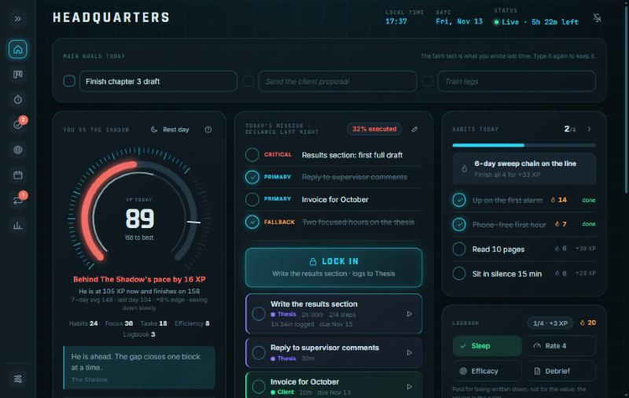
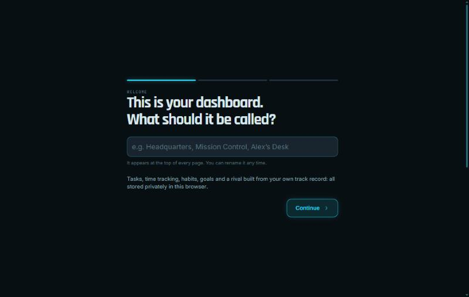
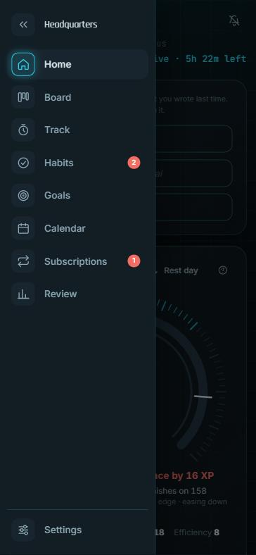
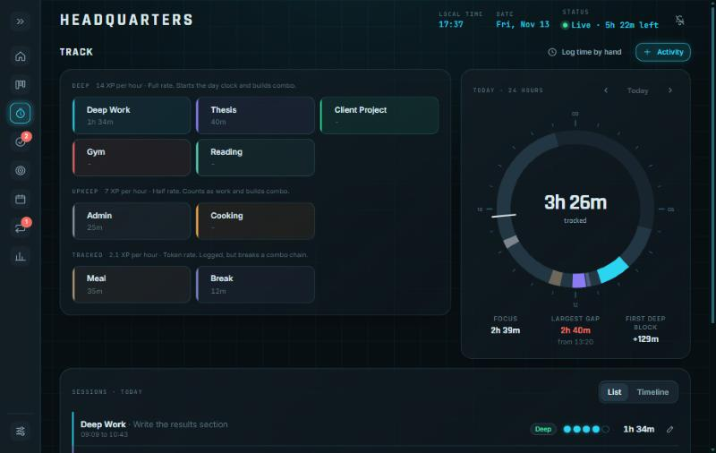
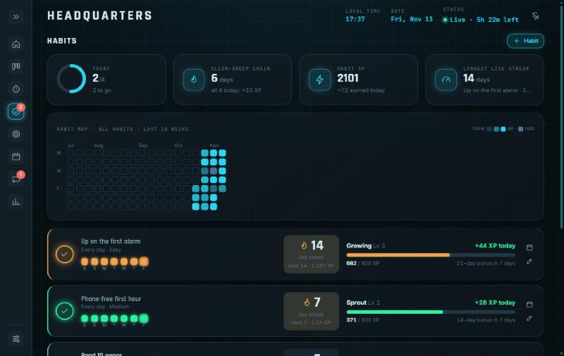
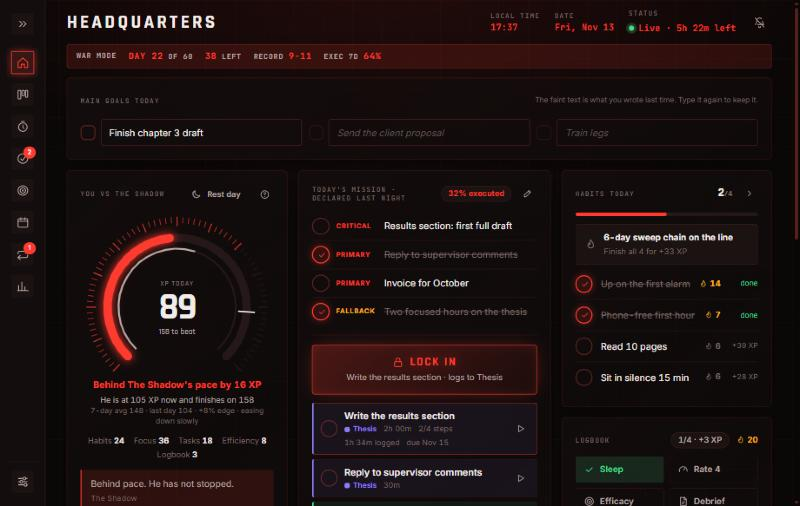
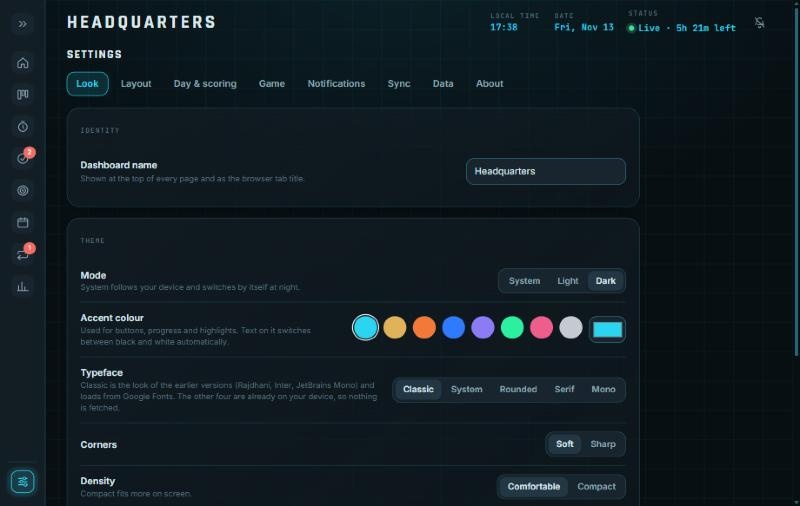

# How to set up and use your dashboard

This guide has two halves. Parts 1 to 5 get your own copy online and installed on your devices. Parts 6 to 9 explain how to use it well.

You do not need to know how to code. Everything is done by clicking through web pages. Allow about 15 minutes for the basic setup and another 15 if you want sync between devices.



## Contents

1. [Put your own copy online](#1-put-your-own-copy-online)
2. [First launch](#2-first-launch)
3. [Install it as an app](#3-install-it-as-an-app)
4. [Turn on notifications](#4-turn-on-notifications)
5. [Optional: sync between devices](#5-optional-sync-between-devices)
6. [The daily loop](#6-the-daily-loop)
7. [The tabs, one by one](#7-the-tabs-one-by-one)
8. [How the scoring works](#8-how-the-scoring-works)
9. [Make it yours](#9-make-it-yours)
10. [Security and privacy](#10-security-and-privacy)
11. [Backups, updates and troubleshooting](#11-backups-updates-and-troubleshooting)
12. [Upgrading from version 4](#12-upgrading-from-version-4)

---

## 1. Put your own copy online

You need two free accounts: [GitHub](https://github.com) (holds your copy of the code) and [Netlify](https://www.netlify.com) (puts it on the web).

1. **Copy the project.** Open the project page on GitHub and press **Fork** (top right). You now have your own copy under your account.
2. **Connect Netlify.** Sign in to Netlify, choose **Add new site**, then **Import an existing project**, then **GitHub**. Approve the connection and pick your fork.
3. **Deploy.** Netlify reads the settings from the project by itself. You do not need to type a build command or a folder. Press **Deploy**.
4. **Open it.** After about a minute Netlify shows an address such as `https://something-random.netlify.app`. That is your dashboard. You can change the name under **Site configuration > Change site name**.

Every time you change something in your GitHub copy, Netlify redeploys by itself.

Prefer not to connect GitHub? Install the [Netlify CLI](https://docs.netlify.com/cli/get-started/) and run `netlify deploy --prod` in the project folder. Do not drag the whole project folder onto Netlify: that uploads everything in it, including files that are not part of the site.

> The site is the same empty shell for anyone who opens the address. Your tasks, habits and history are **not** stored on it. See [Security and privacy](#10-security-and-privacy).

## 2. First launch

The first time you open your address you get three short screens.



1. **Name.** Type what the dashboard should be called. It appears at the top of every page.
2. **Look.** Pick light, dark or "match my device", and an accent colour.
3. **Your day.** Set the hours you intend to work, how many focused hours you aim for, and what your rival is called. Leave the last box ticked to start with a few example activities, tags and habits. They are all editable.

Everything here can be changed later in **Settings**.

## 3. Install it as an app

Installing gives the dashboard its own window and icon, and on phones it is required for notifications.

| Device | Browser | How |
|---|---|---|
| Windows | Chrome or Edge | Open your address. Click the install icon at the right end of the address bar, or open the menu (three dots) and choose **Install** (Chrome: **Cast, save and share > Install page as app**; Edge: **Apps > Install this site as an app**). |
| Mac | Chrome or Edge | Same as Windows. |
| Mac | Safari (macOS 14 or later) | **File > Add to Dock**. |
| iPhone, iPad | Safari | Tap the **Share** button, then **Add to Home Screen**. Open it from the home screen from now on. |
| Android | Chrome | Open the menu (three dots), then **Add to Home screen** or **Install app**. |

It works offline once it has been opened at least once.

## 4. Turn on notifications

Tap the **bell** in the top right corner and allow notifications when the browser asks. Do this on each device you want them on. Tap the bell again at any time to send yourself a test.

There are two levels:

| Level | What you get | What it needs |
|---|---|---|
| While the app is open | Reminders appear as long as the app or its tab is open somewhere, even in the background. | Nothing extra. |
| With the app closed | Reminders arrive even when the app is fully shut. | The sync setup in Part 5. |

Where it works:

| Device | Works in |
|---|---|
| Windows | Chrome, Edge, Firefox. In a tab or installed. |
| Mac | Chrome, Edge, Firefox, and Safari on macOS 13 or later. |
| Android | Chrome, Edge, Firefox. Best when installed. |
| iPhone, iPad | iOS 16.4 or later, **only after** the app is added to the home screen (Part 3) and opened from there. |

If the bell says notifications are blocked, allow them for your site in the browser's site settings (the padlock or tune icon in the address bar), and on phones also in the system notification settings.

You choose which reminders are sent, and you can rewrite every sentence they use, under **Settings > Notifications**.


## 5. Optional: sync between devices

Without this step each device keeps its own separate dashboard. With it, your phone and computer stay in step, and notifications arrive with the app closed.

It uses your own free [Supabase](https://supabase.com) project. Your data sits in your project, behind your own login.

**A. Create the database**

1. Sign up at Supabase and create a **New project**. Choose a region near you and set a database password (you will not need it again here).
2. Open **SQL Editor**, choose **New query**, paste in the whole of the file `supabase/schema.sql` from the project, and press **Run**. It should say "Success".

**B. Tell Supabase where your site lives**

3. Open **Authentication > URL Configuration**. Set **Site URL** to your Netlify address.

**C. Collect four values**

4. Open **Project Settings > API** (it may be labelled **API Keys** and **Data API**). You need:
   - the **Project URL**, which looks like `https://abcdefgh.supabase.co`
   - the **publishable** key (older projects call it the **anon** key). This one is safe to be public.
   - the **secret** key (older projects call it **service_role**). This one must never be shared, committed or pasted into the app.
5. Make a push key pair. With [Node.js](https://nodejs.org) installed, open a terminal in the project folder and run:

   ```bash
   node tools/generate-vapid.mjs
   ```

   It prints a public key and a private key. Nothing is saved or sent anywhere.

**D. Give them to Netlify**

6. In Netlify open **Site configuration > Environment variables** and add these five:

   | Name | Value |
   |---|---|
   | `SUPABASE_URL` | the Project URL |
   | `SUPABASE_ANON_KEY` | the publishable (anon) key |
   | `SUPABASE_SERVICE_ROLE_KEY` | the secret (service_role) key |
   | `VAPID_PUBLIC_KEY` | the public key from step 5 (the long one) |
   | `VAPID_PRIVATE_KEY` | the private key from step 5 (the short one) |

7. Open **Deploys** and choose **Trigger deploy > Deploy site**, so the new values take effect.

**E. Create your account**

8. Open your dashboard, go to **Settings > Sync**, type your email and a password of at least eight characters, and press **Create account**. If Supabase sends a confirmation email, click the link in it and then sign in.
9. On every other device: open the dashboard and, on the welcome screen, press **I already have a dashboard. Sign in**. Your dashboard loads and that device stays in step from then on. If a device already has its own dashboard, it asks which one to keep.
10. On each device, tap the **bell** once more so it registers for closed-app notifications.

**F. Close the door behind you (recommended)**

11. In Supabase open **Authentication > Sign In / Providers** and turn off **Allow new users to sign up**. Your account keeps working, and nobody else can create one in your project.

**Checking it works.** Open `https://YOUR-SITE.netlify.app/.netlify/functions/push-health` in a browser. It lists each part of the setup as true or false and never shows a key. If every entry is true, tap the bell to send a test, then lock your screen.

## 6. The daily loop

The dashboard is built around one loop. It takes about two minutes in the morning and two at night.

**Morning**

1. **Write out your main goals.** These are the big ones you are working toward, not today's tasks. The strip at the top of Home is empty every morning and shows what you wrote last time in faint text. Typing them out again keeps them in front of you, and each one earns a little XP. Add as many as you like.
2. **Declare the mission.** The morning brief opens by itself near the start of your day. Name one critical objective, up to three primary ones, and a fallback (the least you will accept from today).
3. **Press Lock in.** It starts the timer on the top task in your Today list and fills the screen with it. Stopping is locked for the first 90 seconds, which is usually all it takes to get going.

**During the day**

4. **Keep a timer running.** Start and stop activities on the Track tab, or lock in on tasks. Back-to-back blocks build a combo that multiplies your XP.
5. **Check off habits** as you do them.
6. **Watch the dial.** The thick arc is your XP. The thin arc is where your rival is right now. The notch is where he will finish.

**Night**

7. **Debrief.** Thirty minutes before your day ends, the debrief opens. Tick off what you actually did, write what went right, what went wrong and the fix, and declare tomorrow's critical objective. Tomorrow morning becomes a confirmation instead of a decision.

When the day rolls over it is scored: a win if you beat the rival, a loss if not. Finished tasks are cleared from the board's Done column.

## 7. The tabs, one by one

The tabs live in the strip on the left. Press the arrows at the top of the strip to show their names. On a phone, press the menu button.



### Home

Everything for today on one page: your main goals, you against the rival, the mission, the Lock in button with your top three tasks, habits, and the logbook.

- **Top tasks** are the first three in the board's Today column. Click one to select it. **Lock in** always starts the selected task, and the line under the button says which activity will be timed.
- Press the question mark on the dial card for today's numbers: where your XP came from and how the rival's target was set.
- **Rest day** (top of the dial card) marks today as not scored. See [rest days](#rest-days).
- The **logbook** has four entries: sleep, session ratings, efficacy, and the debrief. Each one you fill in earns a little XP. Tap any of them to fill it in.

### Board


A kanban board. Drag tasks between columns. On a phone, press and hold a task, then drag.

- **Tags** colour the task and decide where its time goes. Open **Tags** to link each tag to an activity. When you lock in on a task tagged "Thesis", the Thesis timer runs, not the general one.
- **Steps.** Open a task and add steps. The task shows a progress bar. Click the bar to tick steps off without opening the task.
- **Duplicate.** Open a task and press **Duplicate**. A new task opens with the same name, tag, estimate, deadline, notes and steps, ready to edit.
- **Columns** can be renamed, recoloured, reordered, added and removed.
- The **Done** column empties itself each morning. Turn that off under **Settings > Day & scoring** if you prefer to clear it by hand.

### Track



- Click an activity to start its timer. Click it again to stop. Only one runs at a time.
- The **24-hour ring** shows your day at a glance: each arc is a session, the lighter band is your working hours, the line is now. "Largest gap" is the longest stretch of your working hours with nothing logged.
- Switch the session list to **Timeline** for a strip view with one lane per kind of activity.
- Click any session to correct its times. Use **Log time by hand** for something you forgot to track.
- Rate each session from 1 to 5 with the dots. Ratings feed your efficiency figure and the logbook.

Each activity has a weight: **Deep** earns full XP, **Upkeep** half, **Tracked** a token amount. Mark meals, naps and scrolling as a **break**: breaks never count as work and reset the combo.

### Habits



- Each habit shows its **streak** and its **XP level** in full view, and what checking it today will earn.
- The **clean-sweep chain** counts consecutive days on which you did every habit that was due. Each day in the chain adds to the bonus.
- The **habit map** at the top shows all habits together. Press the calendar icon on a habit for its own map. Click any past day on a habit's own map to correct it.
- Longer streaks multiply the XP of a check-off: 1.1x from 7 days, 1.25x from 14, 1.5x from 21, 1.75x from 30, 2x from 66.

### Goals

A goal breaks into milestones, and a milestone into tasks. Progress is counted across all of them. Press the board icon next to a task to send it to today's list.

### Calendar

The month at a glance: a dot for each day's result, its XP, focused hours and sleep. Open any day to see the detail, log sleep, mark it as a rest day, or pin an emoji to it.

### Subscriptions

Anything that bills on a schedule. It shows what you pay per month and per year and when the next payment leaves. You get a reminder the day before, at 10:00.

### Review

The week in numbers, a weekly self-rating, the journal, and your long-term record. **Copy weekly report** puts the whole week on the clipboard as plain text.

## 8. How the scoring works

### XP

| What | XP |
|---|---|
| An hour of Deep work | 14 |
| An hour of Upkeep | 7 |
| An hour of Tracked time | about 2 |
| A habit checked | 12 |
| A task completed | 9 |
| Efficiency (average session rating) | up to 10 |
| Clean sweep (every due habit done) | 15, plus 3 for each day in the chain, up to 45 |
| Each logbook entry | 3 |
| Each main goal written out | 2, for up to 5 goals |
| Social media beyond 20 minutes | minus 0.4 per minute |

Back-to-back work blocks (at most 10 minutes apart, at least 5 minutes each) build a **combo**: 1.2x for the second block, 1.4x for the third, up to 3x. A longer gap or a break resets it.

All of these numbers can be changed under **Settings > Day & scoring**.

### The rival

Every morning your rival sets a bar for the day, built from what you actually did:

- 60% of your average over the last seven scored days, plus 40% of your last scored day,
- plus his edge (8% unless you change it), so he is always one step ahead of your recent form.

Three rules keep him fair:

- He never asks for more than your best day of the last 30. You have already done it once.
- He drops by at most 8% a day, so a bad week is not rewarded straight away.
- He never goes below a quarter of a full target day.

For your first three days he has no history, so he runs at 60% of a full target day. Press the question mark on the dial card to see today's numbers.

### Rest days

A rest day is not scored at all. No win, no loss, no reputation change, and habit streaks freeze instead of breaking. You get one in any seven days unless you change the allowance under **Settings > Game**. You can also mark a past day as rest from the Calendar.

### Mission, execution, rank

**Execution** is how much of the mission you declared you actually completed: the critical objective counts for 50%, the primaries for 35%, the fallback for 15%. If you leave a tier blank, its weight goes to the others.

**Reputation** changes once a day from your execution: 80% or more adds 3, 60% adds 1.5, 40% adds 0.5, 20% takes 1, under 20% takes 3, and declaring nothing takes 2. Reputation decides your **rank**.

### Campaign



A campaign is a fixed-length push (60 days by default). While it runs:

- the whole dashboard switches to the red theme, whatever your own theme is,
- starting a break with under 25 minutes of focus on the board is challenged first (never blocked),
- the win and loss record counts from the campaign's first day.

Start and end campaigns under **Settings > Game**. Ending one archives the result under Review and restores your own theme.

## 9. Make it yours



| Where | What you can change |
|---|---|
| **Settings > Look** | Dashboard name. Light, dark or system. Accent colour (any colour). Typeface. Corners. Density. A background image, with sliders for dimming, blur and panel opacity. |
| **Settings > Layout** | Sidebar as an icon strip or fully hidden. Which tabs show, and in what order. |
| **Settings > Day & scoring** | Working hours. Daily targets. Every XP value. Weekly check-in categories. |
| **Settings > Game** | Turn the rival, missions and rank on or off. Rename the rival, the Lock in button, the mission panel, rank and reputation. Edit the rank ladder. The rival's edge and voice. Rest day allowance. Campaigns. |
| **Settings > Notifications** | Which reminders are sent and when. Every sentence they use. |

The background image stays on the device you chose it on. It is never uploaded. The dimming and panel opacity have lower limits so text stays readable on any photo.


**Keyboard shortcuts:** `1` to `9` jump to a tab, `0` opens Settings, `L` locks in, `N` adds a task, `S` stops the timer, `[` expands the sidebar, `?` shows the list.

## 10. Security and privacy

**Does hosting on Netlify make my data secure?** Netlify never has your data. It serves the app's files, the same files to everyone. What matters is where the data lives:

| Setup | Where your data is | Who can read it |
|---|---|---|
| Without sync | In the browser on your device. | Anyone who can use that browser profile on that device. Nobody over the internet. |
| With sync | In the browser, and in one row of your own Supabase database. | Only someone signed in as you. The database itself refuses every other request. |

What the project does to keep it that way:

- **No third-party scripts, no analytics, no tracking.** A strict Content-Security-Policy tells the browser to run scripts only from your own site.
- **One optional outside request.** The default "Classic" typeface loads from Google Fonts. Choose any other typeface under Settings > Look and nothing is fetched from anyone.
- **Row level security.** Every database row is tied to a signed-in user, and the rules live in the database, not in the app.
- **Secrets stay on the server.** The secret database key and the private push key exist only in Netlify's environment variables. They are never in the code and never sent to a browser.
- **Notifications only go to you.** Only a signed-in user can register a device, and each notification is sent only to the devices of the person who queued it.

What you should do:

- Use a strong, unique password for sync. It is the only thing between the internet and your data.
- Turn off new sign-ups in Supabase after creating your account (Part 5, step 11).
- Never paste the **secret** (service_role) key or the **private** push key anywhere except Netlify's environment variables. If either leaks, replace it in Supabase or rerun the key generator, update Netlify, and redeploy.
- Lock your devices. Without sync, whoever can open your browser can open your dashboard.
- Export a backup now and then (next section).

## 11. Backups, updates and troubleshooting

**Backup.** **Settings > Data > Export backup** downloads everything as one file. **Import backup** restores it. Without sync, this file is the only copy besides the browser itself, and clearing your browser's site data deletes the dashboard.

**Updating.** When the original project improves, open your fork on GitHub and press **Sync fork**. Netlify redeploys by itself. Your data is not touched.

**Trying it with sample data.** With Node.js installed, run `npm run demo` in the project folder and import the file it creates.

| Problem | Try this |
|---|---|
| No install option in the browser | Use Chrome, Edge or Safari, and make sure you opened the `https://` address. |
| The bell says blocked | Allow notifications for the site in the browser's site settings, and in the system settings on phones. |
| No notifications on iPhone | Add to Home Screen first, open it from the home screen, then tap the bell. Needs iOS 16.4 or later. |
| Notifications only arrive while the app is open | Finish Part 5, sign in, and tap the bell again on that device. |
| Notifications still not arriving | Open `/.netlify/functions/push-health` on your site. Anything marked false is the part to fix. |
| "Sync is not set up yet" | The five Netlify variables are missing, or the site was not redeployed after adding them. |
| Sign-in says the email is not confirmed | Click the link in the confirmation email, or turn off "Confirm email" in Supabase under Authentication. |
| Two devices show different things | On the device with the right dashboard, open Settings > Sync and press **Use this device's everywhere**. On the other, press **Load my account's here**. |
| The page looks out of date | Close the app completely and open it again. |

## 12. Upgrading from version 4

Version 5 is a rebuild and stores its data differently.

1. Deploy version 5 to the **same** Netlify site as before.
2. Open it in the browser you used for version 4, go to **Settings > Data**, and press **Import from v4**. Activities and their sessions, habits and their history, the board, goals, subscriptions and the journal come across. The win and loss record starts fresh.
3. Deploy with `netlify deploy --prod` from now on, or connect the repository to Netlify. Do **not** use `--dir .` any more, and do not drag the project folder onto Netlify: both send the whole folder, old files included.
4. Version 4 kept its data in a Supabase table that anyone with the page source could read. After importing, delete the old `app_state` table (or the whole old project), run the new `supabase/schema.sql` (it replaces the old push tables by itself), and follow Part 5 to set up sync with a login. If you keep the same Netlify site, the only new variable to add is `SUPABASE_ANON_KEY`.
