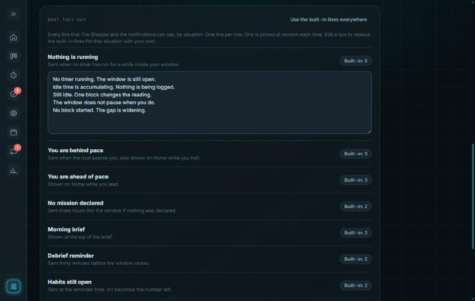
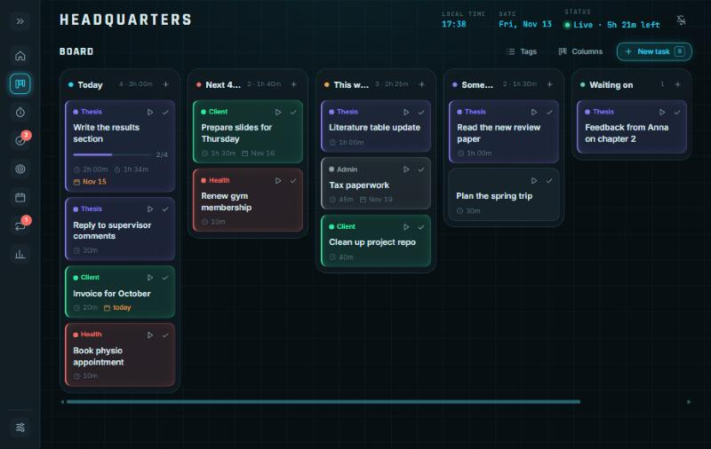
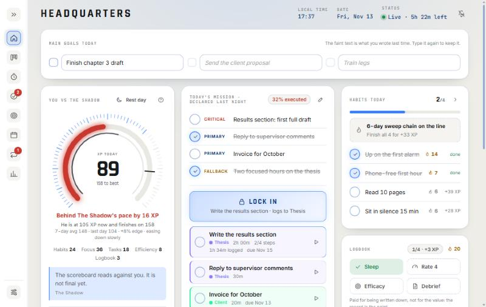

# How to set up and use your dashboard

This guide has two halves. Parts 1 to 5 get your own copy online and installed on your devices. Parts 6 to 9 explain how to use it well.

You do not need to know how to code. Everything is done by clicking through web pages. Allow about 15 minutes for the basic setup and another 15 if you want sync between devices.


## Contents

1. [Put your own copy online](#1-put-your-own-copy-online)
2. [First launch](#2-first-launch)
3. [Install it as an app](#3-install-it-as-an-app)
4. [Turn on notifications](#4-turn-on-notifications)
5. [Optional: sync between devices](#5-optional-sync-between-devices)
6. [The daily loop](#6-the-daily-loop)
7. [The tabs, one by one](#7-the-tabs-one-by-one)
8. [How the scoring works](#8-how-the-scoring-works)
9. [Make it yours](#9-make-it-yours)
10. [Security and privacy](#10-security-and-privacy)
11. [Backups, updates and troubleshooting](#11-backups-updates-and-troubleshooting)
12. [Upgrading from version 4](#12-upgrading-from-version-4)

---

## 1. Put your own copy online

You need two free accounts: [GitHub](https://github.com) (holds your copy of the code) and [Netlify](https://www.netlify.com) (puts it on the web).

1. **Copy the project.** Open the project page on GitHub and press **Fork** (top right). You now have your own copy under your account.
2. **Connect Netlify.** Sign in to Netlify, choose **Add new site**, then **Import an existing project**, then **GitHub**. Approve the connection and pick your fork.
3. **Deploy.** Netlify reads the settings from the project by itself. You do not need to type a build command or a folder. Press **Deploy**.
4. **Open it.** After about a minute Netlify shows an address such as `https://something-random.netlify.app`. That is your dashboard. You can change the name under **Site configuration > Change site name**.

Every time you change something in your GitHub copy, Netlify redeploys by itself.

Prefer not to connect GitHub? Install the [Netlify CLI](https://docs.netlify.com/cli/get-started/) and run `netlify deploy --prod` in the project folder. Do not drag the whole project folder onto Netlify: that uploads everything in it, including files that are not part of the site.

> The site is the same empty shell for anyone who opens the address. Your tasks, habits and history are **not** stored on it. See [Security and privacy](#10-security-and-privacy).

## 2. First launch

The first time you open your address you get three short screens.


1. **Name.** Type what the dashboard should be called. It appears at the top of every page.
2. **Look.** Pick light, dark or "match my device", and an accent colour.
3. **Your day.** Set the hours you intend to work, how many focused hours you aim for, and what your rival is called. Leave the last box ticked to start with a few example activities, tags and habits. They are all editable.

Everything here can be changed later in **Settings**.

## 3. Install it as an app

Installing gives the dashboard its own window and icon, and on phones it is required for notifications.

| Device | Browser | How |
|---|---|---|
| Windows | Chrome or Edge | Open your address. Click the install icon at the right end of the address bar, or open the menu (three dots) and choose **Install** (Chrome: **Cast, save and share > Install page as app**; Edge: **Apps > Install this site as an app**). |
| Mac | Chrome or Edge | Same as Windows. |
| Mac | Safari (macOS 14 or later) | **File > Add to Dock**. |
| iPhone, iPad | Safari | Tap the **Share** button, then **Add to Home Screen**. Open it from the home screen from now on. |
| Android | Chrome | Open the menu (three dots), then **Add to Home screen** or **Install app**. |

It works offline once it has been opened at least once.

## 4. Turn on notifications

Tap the **bell** in the top right corner and allow notifications when the browser asks. Do this on each device you want them on. Tap the bell again at any time to send yourself a test.

There are two levels:

| Level | What you get | What it needs |
|---|---|---|
| While the app is open | Reminders appear as long as the app or its tab is open somewhere, even in the background. | Nothing extra. |
| With the app closed | Reminders arrive even when the app is fully shut. | The sync setup in Part 5. |

Where it works:

| Device | Works in |
|---|---|
| Windows | Chrome, Edge, Firefox. In a tab or installed. |
| Mac | Chrome, Edge, Firefox, and Safari on macOS 13 or later. |
| Android | Chrome, Edge, Firefox. Best when installed. |
| iPhone, iPad | iOS 16.4 or later, **only after** the app is added to the home screen (Part 3) and opened from there. |

If the bell says notifications are blocked, allow them for your site in the browser's site settings (the padlock or tune icon in the address bar), and on phones also in the system notification settings.

These reach your device even with the app closed, sent at their time: the morning brief, a missing mission, the debrief, habits still open, a payment tomorrow, the running timer, nothing running, the rival passing you, you pulling ahead of him while a timer runs, and the end of the 15 minutes after you hold off a break.

These are noticed by the app itself, so they reach your device while the app is open somewhere (a tab or the installed app, even minimised or in the background): a new record, a level or rank, how the month ended, false starts, and pulling ahead when no timer is running.

Something you do in the app itself (declaring a rest day, saving a debrief) is shown on screen only, since you are already looking.

**Nothing is running** is a reminder once in a while, not a nag: with little done it comes at most every hour (you can change that), it waits longer as your focus hours add up toward your daily target, it stops once you reach the target, and there are never more than five in a day.

If you are ever signed out of your account, the device tells you with its own notification (a push cannot reach a signed-out device), once when it happens and once a day until you sign in again.

You choose which reminders are sent, and you can rewrite every sentence they use, under **Settings > Notifications**. With sync on, the same page shows when the day's reminders were last scheduled, how many are waiting and when the next one is due. If that line shows an error, press **Schedule again**.



## 5. Optional: sync between devices

Without this step each device keeps its own separate dashboard. With it, your phone and computer stay in step, and notifications arrive with the app closed.

It uses your own free [Supabase](https://supabase.com) project. Your data sits in your project, behind your own login.

**A. Create the database**

1. Sign up at Supabase and create a **New project**. Choose a region near you and set a database password (you will not need it again here).
2. Open **SQL Editor**, choose **New query**, paste in the whole of the file `supabase/schema.sql` from the project, and press **Run**. It should say "Success".

**B. Tell Supabase where your site lives**

3. Open **Authentication > URL Configuration**. Set **Site URL** to your Netlify address.

**C. Collect four values**

4. Open **Project Settings > API** (it may be labelled **API Keys** and **Data API**). You need:
   - the **Project URL**, which looks like `https://abcdefgh.supabase.co`
   - the **publishable** key (older projects call it the **anon** key). This one is safe to be public.
   - the **secret** key (older projects call it **service_role**). This one must never be shared, committed or pasted into the app.
5. Make a push key pair. With [Node.js](https://nodejs.org) installed, open a terminal in the project folder and run:

   ```bash
   node tools/generate-vapid.mjs
   ```

   It prints a public key and a private key. Nothing is saved or sent anywhere.

**D. Give them to Netlify**

6. In Netlify open **Site configuration > Environment variables** and add these five:

   | Name | Value |
   |---|---|
   | `SUPABASE_URL` | the Project URL |
   | `SUPABASE_ANON_KEY` | the publishable (anon) key |
   | `SUPABASE_SERVICE_ROLE_KEY` | the secret (service_role) key |
   | `VAPID_PUBLIC_KEY` | the public key from step 5 (the long one) |
   | `VAPID_PRIVATE_KEY` | the private key from step 5 (the short one) |

7. Open **Deploys** and choose **Trigger deploy > Deploy site**, so the new values take effect.

**E. Create your account**

8. Open your dashboard, go to **Settings > Sync**, type your email and a password of at least eight characters, and press **Create account**. If Supabase sends a confirmation email, click the link in it and then sign in.
9. On every other device: open the dashboard and, on the welcome screen, press **I already have a dashboard. Sign in**. Your dashboard loads and that device stays in step from then on. If a device already has its own dashboard, it asks which one to keep.
10. On each device, tap the **bell** once more so it registers for closed-app notifications.

**F. Close the door behind you (recommended)**

11. In Supabase open **Authentication > Sign In / Providers** and turn off **Allow new users to sign up**. Your account keeps working, and nobody else can create one in your project.

**Checking it works.** Open `https://YOUR-SITE.netlify.app/.netlify/functions/push-health` in a browser. It lists each part of the setup as true or false and never shows a key. If every entry is true, tap the bell to send a test, then lock your screen.

## 6. The daily loop

The dashboard is built around one loop. It takes about two minutes in the morning and two at night.

**Morning**

1. **Write out your main goals.** These are the big ones you are working toward, not today's tasks. The strip at the top of Home is empty every morning and shows what you wrote last time in faint text. Typing them out again keeps them in front of you, and each one earns a little XP. Add as many as you like.
2. **Declare the mission.** The morning brief opens by itself near the start of your day. Name one critical objective, up to three primary ones, and a fallback (the least you will accept from today).
3. **Press Lock in.** It starts the timer on the top task in your Today list and fills the screen with it. Stopping is locked for the first 90 seconds, which is usually all it takes to get going. Change how long under **Settings > Day & scoring > How long Lock in holds** (0 lets you stop at once). When the task is finished, press **Mark task as done**: the timer stops and the task is ticked off.

**During the day**

4. **Keep a timer running.** Start and stop activities on the Track tab, or lock in on tasks. Back-to-back blocks build a combo that multiplies your XP. **Rate each Deep block** when it stops: a block pays its full XP only at 5/5 (see [XP](#xp)).
5. **Check off habits** as you do them.
6. **Watch the dial.** The thick arc is your XP. The thin arc is where your rival is right now. The notch is where he will finish.

**Night**

7. **Debrief.** Thirty minutes before your day ends, the debrief opens. Tick off what you actually did, write what went right, what went wrong and the fix, and declare tomorrow's critical objective. Tomorrow morning becomes a confirmation instead of a decision.

When the day rolls over it is scored: a win if you beat the rival, a loss if not. Finished tasks are cleared from the Done column on the Tasks tab.

The result of the day before is announced once: the first time you open the dashboard on a new day, on whichever device you open it. It is not repeated later that day or on your other devices.

## 7. The tabs, one by one

The tabs live in the strip on the left. Press the arrows at the top of the strip to show their names. On a phone, press the menu button.


### Home

Everything for today on one page: your main goals, you against the rival, the mission, the Lock in button with your top three tasks, how many habits are left, and the logbook.

- **The combo** has its own cell on the right of the Lock in block, behind a thin line: 1.0× when nothing is chained, and green once back-to-back blocks push it higher.

- **Your level** is at the left of the top bar on every tab, with your rank and the bar to the next level, in your rank's colour. Press it for your stats: where today's level XP came from, the last 14 days, and the ranks. See [level and rank](#level-and-rank).
- **Top tasks** are the first three in the Today column of the Tasks tab, each with its tag and priority flag. Drag them to reorder. Click one to select it: it is outlined in its tag's colour (in any theme, campaign included) to show which one is chosen. **Lock in** always starts the selected task, and the line under the button says which activity will be timed.
- Press the question mark on the dial card for today's numbers: where your XP came from and how the rival's target was set.
- **Main goals** are the lasting ones. Write them out each morning; yesterday's show faintly as a prompt. Press **Add goal** for another line, and the cross on a line to remove it.
- **The month's record** sits under the dial: one cell per day, green for a day you won, red for one you lost, blue for a rest day. Under it, **Days to win** shows how many of the days left you need to win the month (6/8 means win 6 of the 8 left), beside your **win streak**. It reads Won once the month is secured. The record starts again on the 1st. Press the record to open the calendar.
- The dial has three rings. The outer ticks are your working day, lit as it passes. The share of the day that is left, and the time, is written above the dial. The thick arc is your XP. The thin arc and the notch are the rival's pace now and his target. Each ring's colour can be changed under **Settings > Look > Home dial**.
- **Rest day** (top of the dial card) marks today as not scored. See [rest days](#rest-days).
- **Campaign** (top of the dial card) starts a campaign: give it a name, a start date and a length. While one runs the button reads **End campaign**, which concludes it after you confirm. It is the same as Settings > Game. See [campaign](#campaign).
- The **logbook** has four entries: sleep, session ratings, efficacy, and the debrief. Each one you fill in earns a little XP. Tap any of them to fill it in.

### Tasks



A kanban board (it used to be called Board). Drag tasks between columns. On a phone, press and hold a task, then drag.

- **Tags** colour the task and decide where its time goes. Open **Tags** to link each tag to an activity. When you lock in on a task tagged "Thesis", the Thesis timer runs, not the general one.
- **Activity.** A task can also name its own activity, which wins over its tag's. Leave it on "Follow the tag" for the usual behaviour.
- **Priority.** Open a task and pick **Low**, **Medium** or **High**. A flag shows it right after the task's name, in green, yellow or red. On the Tasks tab a High task also has a bold title, and High tasks breathe: a soft glow in their tag's colour swells and settles every few seconds. Turn it off under **Settings > Layout > High tasks breathe**. Home's top tasks show only the flag. A task goes to the top of its column when it is added as High, raised to High, or moved to another column while High; you can still drag it anywhere after that. **None** hides it.
- **Steps.** Open a task and add steps. The task shows a progress bar. Click the bar to tick steps off without opening the task.
- **Duplicate.** Open a task and press **Duplicate**. A new task opens with the same name, tag, estimate, deadline, notes and steps, ready to edit.
- **Columns** can be renamed, recoloured, reordered, added and removed. With **Settings > Layout > Colour each column** on (the default), each column takes a faint tint of its own colour; turn it off for plain columns.
- The **Done** column empties itself each morning. Turn that off under **Settings > Day & scoring** if you prefer to clear it by hand.

### Track


- Click an activity to start its timer. Click it again to stop. Only one runs at a time.
- While a timer runs, a solid bar at the top shows what is running (with a pulsing dot in its colour), when it started and for how long. Press anywhere on it to stop.
- Drag an activity to reorder it within its group. On a phone, press and hold first.
- The **24-hour ring** shows your day at a glance: each block is a session in its activity's colour, starting and ending exactly where it did; the lighter band is your working hours, the line is now. The blocks draw in from midnight, one after the other. Point at a block and it grows and the middle of the ring names it, with its times and length. Press it to keep it picked: the others dim and an **Edit** button appears in the middle. Press it again to let go. "Largest gap" is the longest stretch of your working hours with nothing logged.
- Switch the session list to **Timeline** for a strip view with one lane per kind of activity.
- Click any session to correct its times. Use **Log time by hand** for something you forgot to track.
- Rate each session of a **Deep** activity from 1 to 5 with the dots. The rating decides how much XP the block pays (5/5 is full; see [XP](#xp)), and feeds your efficiency figure and the logbook. Upkeep and Tracked time are not rated.
- **Colours.** An activity's editor has nineteen colours, red included, and the last swatch (the rainbow) opens your system's colour picker for any colour at all.

Each activity has a weight: **Deep** earns full XP, **Upkeep** half, **Tracked** a token amount. Mark meals, naps and scrolling as a **break**: breaks never count as work and reset the combo.

**Starting a break is challenged.** Press a break and you are asked to work 15 minutes first. **Take it anyway** starts it at once; **Work 15 minutes first** sends you a notification when the 15 minutes are up, and the break is then yours, unchallenged, for 45 minutes. Either choice is recorded. Choose when this happens under **Settings > Game > Breaks**: always (the default), only during a campaign, or never.

### Habits


- Each habit shows its **streak** and its **XP level** in full view, and what checking it today will earn.
- **Not due today?** You can still tick it, and it still earns its XP. It moves to **Done today** marked "done on a day off". Unticking it leaves no miss behind.
- **Notes.** Press the page icon on a habit to open its notes: why it matters, how you do it, what makes it easier. They save when you click away. Once written, the first line shows faintly beside the habit's name; press it to open the notes.
- A habit can also pay **level XP** directly. Open the habit's editor and fill in **Level XP when done**: that amount goes to your level every day you tick it, on top of the share for habits as a whole.
- A habit you tick moves down to **Done today**. Drag a habit to change the order within its section. On a phone, press and hold first.
- The **clean-sweep chain** counts consecutive days on which you did every habit that was due. Each day in the chain adds to the bonus.
- The **habit map** at the top shows all habits together. Press the calendar icon on a habit for its own map. Click any past day on a habit's own map to correct it.
- Longer streaks multiply the XP of a check-off: 1.1x from 7 days, 1.25x from 14, 1.5x from 21, 1.75x from 30, 2x from 66.

### Goals

A goal breaks into milestones, and a milestone into tasks. Progress is counted across all of them. Goals start closed; press one to open it. Drag goals, milestones or tasks to put them in order.

- **Time.** Press play on a task to time it. The time shows on the task, adds up on its milestone, and adds up again on the goal. A milestone with no tasks can be timed directly.
- **Activity.** Edit a goal to choose which activity its time is logged under, so gym work is not counted as deep work.
- **Send to Tasks.** Press the board icon next to a task to put it in today's list. Time on that card counts toward the goal task, and finishing the card ticks the task off.
- **Notes and links.** An open goal ends with **Notes and links**: its notes (what done looks like, anything to remember) and its links. Paste an address and, if you like, a name, and press **Link**: it opens in a new tab. `example.com` gets `https://` added for you; anything that is not a web address is refused. Press the section's header to fold it away. While a goal is closed, or its section is folded, the note's first line shows faintly beside the goal's name and the links show as small chips under its progress line.
- **Milestone notes and links.** Press the pencil on a milestone to edit its name, notes and links. The note's first line shows beside the milestone's name, and its links as chips under it.
- The panel on the right shows overall progress, time spent in total and in the last 7 days, time per goal, and the next open task of each goal.

### Calendar

The month at a glance. Days you won are green and marked Won, days you lost are red and marked Lost, rest days are blue, each with its XP, focused hours and sleep. The bar at the top is the month's record and what it takes to win it. Open any day to see the detail, log sleep, mark it as a rest day, or pin an emoji to it.

### Gym

Your training history, and what to try next time.

The tab reads from top to bottom in the order you use it: how the last weeks went, what to do next, the lifts you follow beside your latest workouts, and everything else folded away at the bottom.

- **Last 12 weeks** shows how many workouts each week had: a bar's height is the count, so weeks with the same number stand level (point at one for its volume). Set your **goal** of workouts a week with the − and + beside the title (3 to start with); it is drawn as a dashed line across the weeks. A week that met it is green, one that fell short is red, and the week under way keeps the accent colour until it meets it. Four numbers sit under it: this week, volume over 30 days, records this month, and **weeks won**, how many weeks since your first workout met the goal.
- **Next workout** is your coach. Tell it your split once (**Set your split**): the sessions in the order you do them, using the names your workouts have in your gym app. The same name can repeat, so upper, lower, upper, lower, arms is five lines. It then works out where you are in the cycle from your latest workouts and lays out the next session from the last time you did that one (press another session's name to lay that one out instead; the one due next keeps a dashed outline, and your pick holds until you log a workout): each exercise with what to aim for beside it, as sets x reps | weight (for example 3 x 9 | 75 kg).
- The targets follow double progression: stay at a weight and add reps until every set reaches the top of your rep range, then add weight and start again from fewer reps. Three sessions without progress at one weight and it suggests backing off by a tenth for a week.
- **Your lifts** are the exercises you want to follow. Press **Choose lifts**, or the plus beside any exercise in the list at the bottom. Until you choose, it shows the ones you do most often.
- **Recent workouts** sits beside your lifts and shows as many as it takes to stand level with them.
- **All exercises** is folded shut at the bottom. Open it to search anything you have ever logged. Press any exercise for its chart (an estimated one-rep max from your best set of the day), your records and your last sessions.

The history is stored on the device, not in your synced dashboard. Your split and chosen lifts do sync, and a backup (Settings > Data) carries the history.

#### Get your workouts in: a file (two minutes, nothing to set up)

This works with openGym (free and open source), Hevy and Strong, and needs no account or subscription.

1. Export from your gym app:
   - **openGym:** Settings > Data & backup > **Export backup (JSON)**.
   - **Hevy:** Profile > Settings > Export & Import Data > **Export Workouts** (a CSV file).
   - **Strong:** Settings > **Export Data** (a CSV file).
2. Get the file to the device you use the dashboard on (it is often easiest to do the whole thing on your phone).
3. On the Gym tab, press **Import file** and choose it.

The file is read on your device and stays there. Do the same after new workouts, for example once a week: workouts already here are updated, new ones are added, and nothing is doubled.

About openGym: out of the box its app keeps everything on your phone, and there is no openGym cloud to sync with. The file above is the way in. For automatic sync there are two ways, both below: let a sync app on your phone copy openGym's backups into a storage bucket (no server), or run openGym's server yourself.

#### Get your workouts in: Hevy sync (about five minutes, once)

You need Hevy Pro (the API key is a Pro feature) and sync turned on in the dashboard (section 5).

1. **Copy your Hevy API key.** On a computer, sign in at hevy.com, open **Settings**, then **Developer**, and copy the key shown there. Treat it like a password.
2. **Give the key to your site.** In Netlify, open your site (Netlify now calls it a project), then **Project configuration > Environment variables** (on older accounts: Site configuration). Press **Add a variable**, choose **Add a single variable**, and fill in:
   - Key: `HEVY_API_KEY`
   - Value: the key you copied

   Press **Create variable**.
3. **Redeploy**, so the site picks the key up. If your site is connected to GitHub: **Deploys > Trigger deploy > Deploy site**. If you deploy from your computer: run `netlify deploy --prod` in the project folder.
4. **Sync.** Open the dashboard, sign in under Settings > Sync if you are not already, open the **Gym** tab and press **Sync now**. The first sync reads your whole history, ten workouts at a time, so a long history takes a minute. After that it only asks Hevy for what changed, each time you open the tab.

If the Gym tab still shows the setup steps, press **Check again**. "Hevy rejected the API key" means the key was pasted wrongly or Hevy Pro has lapsed.

#### Get your workouts in: openGym server sync (only if you run an openGym server)

openGym's app has a switch from "all data stays on this phone" to "connect to my server". There is no server run by openGym: that switch points the app at a server **you** run. If you have one, the dashboard can read your workouts from it, with nothing to export.

What you need first:

- An openGym server that is reachable from the internet over **https**. That means a small always-on machine (a VPS, a home server, a Raspberry Pi) running openGym's Docker image behind a domain name or a tunnel such as Cloudflare Tunnel or Tailscale Funnel. Some hosting companies will run a private openGym for a monthly fee. A server that only exists on your home wifi will not work, because your site's function runs at Netlify and cannot reach it.
- Sync turned on in the dashboard (section 5).

If that sounds like more than you want to look after, stay with the backup file. It gives the dashboard exactly the same data.

1. **Connect the app to your server.** In openGym on your phone: Settings, switch to **Connect to my server**, enter the server's address and sign in. Your history on the phone is uploaded to it.
2. **Create a token.** In openGym: Settings > **API tokens** > new token. Allow it to read **workouts** and **plans**, nothing else. Copy the token (it starts with `ogt_`). It is shown once. Treat it like a password.
3. **Give both to your site.** In Netlify: **Project configuration > Environment variables**, add two variables:
   - `OPENGYM_URL`: your server's address, for example `https://gym.example.com`
   - `OPENGYM_TOKEN`: the token
4. **Redeploy** (Deploys > Trigger deploy, or `netlify deploy --prod`).
5. **Sync.** Open the Gym tab and press **Sync**. From then on it checks your server each time you open the tab and reads again only when something changed.

Hevy and openGym can both be set. The dashboard reads from each and does not double a workout that is in both. openGym numbers its built-in exercises; their names are looked up from openGym's public exercise list the first time they appear.

#### Get your workouts in: openGym backups through a bucket (about twenty minutes, once, no server)

Your history stays on the phone. openGym saves a backup file after every workout, a sync app copies it into a private storage bucket, and the dashboard reads the newest backup from there. Every device you use gets the same workouts, and you never export by hand.

The example uses FolderSync (Android) and Cloudflare R2 (free up to 10 GB; a backup is well under 1 MB). Any app that uploads a folder to S3-compatible storage, and any S3-compatible storage, works the same way. Supabase Storage does not work with FolderSync: FolderSync drops the `/storage/v1/s3` part of Supabase's address.

1. **openGym.** Settings > Data & backup: turn on **Auto-backup on changes**. It writes a dated backup to `Documents/openGym` after each workout or routine edit.
2. **A bucket.** In Cloudflare: R2 Object Storage > **Create bucket**, public access off. Open the bucket's **Settings** and copy its **S3 API** address. A bucket with a jurisdiction has `.eu.` or `.us.` in that address, and it only answers on that address.
3. **A key for the phone.** R2 > API Tokens > **Create Account API token** with **Admin Read & Write** (FolderSync has to list buckets, which a bucket-only token cannot), TTL forever. Note the Access Key ID and Secret Access Key. The secret is shown once.
4. **FolderSync.** Grant it file access (Manage all files), turn battery optimisation off for it, and allow notifications.
   - Accounts > add **Amazon S3**: the two keys, **Custom endpoint** = the S3 API address *without* the bucket name, **Use path-style access** on, **Disable folder objects** on, Region **US-East (North Virginia)**. Press Test.
   - Folderpairs > add: left `Documents/openGym` on the phone, right your bucket, sync type **To right folder** (phone to bucket only, never back). Turn on **Instant sync** and **Sync deletions**, schedule hourly as a safety net, allow any connection including metered, notify on errors only. Leave file encryption off: the dashboard could not read the files.
   - Press Sync and check that the backup appears in the bucket. Log a workout and check that a new one appears by itself.
5. **A key for the dashboard.** Create a second token with **Object Read only**, applied to this one bucket. The dashboard only ever reads.
6. **Give it to your site.** In Netlify: **Project configuration > Environment variables**, add:
   - `OPENGYM_S3_ENDPOINT`: the S3 API address. With or without the bucket name on the end.
   - `OPENGYM_S3_BUCKET`: the bucket's name (can be left out when it is on the end of the address)
   - `OPENGYM_S3_KEY_ID` and `OPENGYM_S3_SECRET`: the read-only token's keys
   - `OPENGYM_S3_REGION`: only for storage other than R2, for example `us-east-1` on AWS. R2 needs nothing here.
7. **Redeploy**, open the Gym tab and press **Sync**. From then on it checks the bucket each time you open the tab and downloads only when there is a newer backup.

If `OPENGYM_URL` is set as well, the dashboard reads the server and ignores the bucket.

#### Get your workouts in: openGym's WebDAV backup (iPhone, about ten minutes, once, no server)

On an iPhone no app can copy openGym's backup folder in the background, so FolderSync has no equivalent there. Instead, openGym uploads a backup itself to a WebDAV drive, and the dashboard reads the newest one. openGym does this **once a day**, so the Gym tab can be up to a day behind. It works the same on Android.

1. **A WebDAV drive.** Make a free account at [Koofr](https://koofr.eu) (10 GB free). Under **Preferences > Password**, generate an **app password** for openGym. Any WebDAV drive works (Nextcloud, for example).
2. **openGym.** Settings > Integrations > **WebDAV backup** > Connect, with the address `https://app.koofr.net/dav/Koofr`, your Koofr email and the app password. Let it make its first backup.
3. **Give it to your site.** In Netlify: **Project configuration > Environment variables**, add:
   - `OPENGYM_DAV_URL`: the same address you gave openGym, for example `https://app.koofr.net/dav/Koofr`. The dashboard looks for the newest `.json` backup there, and in the folders directly inside it, so it finds a backup in an `openGym` folder too.
   - `OPENGYM_DAV_USER`: the email
   - `OPENGYM_DAV_PASSWORD`: the app password (mark it secret)
4. **Redeploy**, open the Gym tab and press **Sync**.

The dashboard only lists the folder and downloads the backup. A bucket (`OPENGYM_S3_`) takes priority over WebDAV when both are set, and a server over both.

### Finance

Where your money goes, by month and by year.

- **Categories.** Each transaction is sorted into a category by the merchant's name. When one is wrong, pick the right category in the list. You are then asked whether to do the same for everything from that merchant: press **Always** and a rule is saved. Rules you make come before the built-in guesses, and a category you chose by hand is never changed by a rule.
- Transfers and savings are left out of both spending and income.
- **Day by day** sits at the top right, beside the four totals: one column for each date of the month, each with its date under it, the bars almost touching. Choose between two views with the switch on the card (it is remembered):
  - **Mixed:** one bar a day, its colour running from red (only spending) through amber to green (only income). Your spending sets the scale, so ordinary days fill the chart; a bigger day, such as a salary or the rent, is cut at the top with a small break mark and its amount written above it.
  - **Split:** spending rises from a middle line in red and income hangs below it in green, each on its own scale, so neither squashes the other.

  The amounts run up the side in round steps. Point at a day to see its totals above the chart; press it to keep that day picked, which also shows only that day's transactions in the list (press it again, or **Clear**, to let go). With nothing picked, the line above the chart is your average spending a day. In the year view this is **Month by month**: press a month to open it. Switch between **Month** and **Year** at the top right.
- **Where it went** is a ring with one rounded, glowing slice per category; it grows in from the top, one slice after the next. Point at a slice, or at its line in the list beside it, and the slice grows and the middle of the ring names it. **Press slices to pick them, as many as you like**: the middle and the line under the list add up what you picked, and the transactions show only those categories. Press a picked one again to drop it, or **Clear** for everything.
- **Sort many at once.** Tick the box at the start of each transaction (or **Select all shown**), choose a category in the bar that appears and press **Set category**. They count as sorted by hand, so no rule moves them later.
- The cog opens categories, your rules, linked banks and the option to remove all transactions.

With sync on, your transactions are kept in your own database as well as on the device, so every device shows the same. Without sync they stay on the device you imported them on.

#### Get your transactions in: a statement file (works with any bank)

1. On your bank's website, download your transactions for the period you want.
   - **ABN AMRO:** Internet Banking > your account > **Download transactions** (Mutaties downloaden). Choose TXT, XLS or CAMT.053.
   - **Revolut:** the account > **Statement** > choose **Excel (CSV)** and the period.
   - **Any other bank:** choose CSV if it is offered, or CAMT.053.
2. On the Finance tab, press **Import file** and choose the file.

ABN AMRO's TXT, Revolut's CSV and CAMT.053 are read as they are. For another bank's CSV the columns are recognised by their names; if they are not, you are asked once which column is the date, the amount and the description. Importing the same file twice adds nothing.

#### Get your transactions in: link your bank (about fifteen minutes, once)

This uses [Enable Banking](https://enablebanking.com), a licensed provider that connects to most European banks. Access is read-only: it can list your accounts and read transactions, and it cannot move money. Their terms allow private individuals to use it with their own accounts; check the current terms when you sign up.

You need sync turned on in the dashboard (section 5).

1. **Add the finance tables to your database.** In Supabase, open your project, then **SQL Editor > New query**. Paste the whole of [`supabase/schema.sql`](supabase/schema.sql) from this repository and press **Run**. It is safe to run again: it adds the `transactions` and `bank_links` tables and leaves everything else alone.
2. **Make an Enable Banking account.** Go to enablebanking.com/sign-in, enter your email, and open the link they send you. That signs you in to their Control Panel.
3. **Register an application.** In the Control Panel open **API applications** in the top menu and fill in **Add a new application**:
   - Environment: **Production**
   - Private key: leave the default (your browser generates it)
   - Application name: anything, for example "My dashboard"
   - Redirect URLs: your site's address with a slash at the end, for example `https://your-site.netlify.app/`

   Press **Register**. A file ending in `.pem` is saved to your downloads. Its name, without `.pem`, is your **application id**. The file itself is your **private key**: keep it private.
4. **Activate it with your own accounts.** The new application shows as **Inactive**. Press **Activate by linking accounts**, choose your bank and approve on your bank's own page. Do this for each bank you want. The application then shows as **Active**. It can only read the accounts you linked this way, which is what keeps it in the free, personal mode.
5. **Give the two values to your site.** In Netlify: **Project configuration > Environment variables > Add a variable > Add a single variable**, twice:
   - Key `ENABLEBANKING_APP_ID`, value: the application id
   - Key `ENABLEBANKING_PRIVATE_KEY`, value: open the `.pem` file in a text editor (Notepad, TextEdit) and paste everything in it, including the lines that begin with `-----BEGIN` and `-----END`
6. **Redeploy**, as in step 3 of the Hevy instructions above.
7. **Link the bank in the dashboard.** Open the **Finance** tab, press **Link a bank**, choose your country and bank, and press **Continue to your bank**. Approve on your bank's page. You come back to the dashboard with a message that the bank is linked.
8. **Read your transactions.** Press **Sync** on the Finance tab. The first read goes back up to a year, as far as your bank allows. After that the tab reads new transactions when you open it, at most every six hours.

Good to know:

- Banks ask you to approve again about every 180 days. The Finance tab tells you when a link has expired; press **Link a bank** again.
- Yes, you approve at your bank twice in total: once to activate the application (step 4) and once from the dashboard (step 7). That is how Enable Banking's personal mode works.
- If your bank is not in the list, statement files still give you the same tab.
- To stop: the cog on the Finance tab > **Unlink**. That ends the session at the bank as well.

### Shopping

A list in two halves: **To buy** and **Bought**, each divided into your own lists (Groceries and Products to begin with; press **Lists** to change them).

- Type what you need, pick the list, and press **Add**. An amount is optional.
- Tick something and it moves to **Bought**. Untick it there when you need it again and it moves back. Adding something that is already in Bought also brings it back, so nothing is listed twice.
- **Expiry dates.** Press the calendar on a bought item and pick the date. Things that expire soonest are at the top, marked when they have two days or less. When the date has passed the item returns to **To buy** by itself, with a note of when it ran out.
- The dashboard remembers how long an item lasted and fills the expiry date in the next time you tick it off. Change it on the row if this one differs.
- The search box looks through both halves.

### Subscriptions

Anything that bills on a schedule. It shows what you pay per month and per year and when the next payment leaves. You get a reminder the day before, at 10:00.

### Review

The week in numbers, a weekly self-rating, the journal, and your long-term record. **Copy weekly report** puts the whole week on the clipboard as plain text.

## 8. How the scoring works

### XP

| What | XP |
|---|---|
| An hour of Deep work | 14 at 5/5 focus (see below) |
| An hour of Upkeep | 7 |
| An hour of Tracked time | about 2 |
| A habit checked | 12 |
| A task completed | 9 |
| Efficiency (average session rating) | up to 10 |
| Clean sweep (every due habit done) | 15, plus 3 for each day in the chain, up to 45 |
| Each logbook entry | 3 |
| Each main goal written out | 2, for up to 5 goals |
| Social media beyond 20 minutes | minus 0.4 per minute |

**Deep work pays by how focused it was.** From 23 November 2026, a Deep block of five minutes or more pays its full XP only when you rate it 5/5; 4/5 pays 80%, 3/5 60%, 2/5 40% and 1/5 20%. A block you have not rated yet, the running one included, pays as a 3/5, so rating is always worth doing: a 4 or a 5 earns more. The same share applies to the level XP for Deep work. Blocks from before that date keep paying as they always did, so your level does not move.

Back-to-back work blocks (at most 10 minutes apart, at least 5 minutes each) build a **combo**: 1.2x for the second block, 1.4x for the third, up to 3x. A longer gap or a break resets it.

All of these numbers can be changed under **Settings > Day & scoring**.

### The rival

Every morning your rival sets a bar for the day, built from what you actually did:

- 60% of your average over the last seven scored days, plus 40% of your last scored day,
- plus his edge (8% unless you change it), so he is always one step ahead of your recent form.

Three rules keep him fair:

- He never asks for more than your best day of the last 30. You have already done it once.
- He drops by at most 8% a day, so a bad week is not rewarded straight away.
- He never goes below a quarter of a full target day.

For your first three days he has no history, so he runs at 60% of a full target day. Press the question mark on the dial card to see today's numbers.

### Days that run past midnight

If you work late, set an end time earlier than the start under **Settings > Day & scoring**, for example 07:00 to 01:00. The day then runs with your hours. It turns over halfway between the end of one window and the start of the next (04:00 in that example), and until then it is still the same day: XP, habits, the mission and the win or loss all belong to it. Days already scored keep their numbers. Use the same version of the dashboard on all your devices, or they will disagree about which day a late session belongs to.

### Rest days

A rest day is not scored at all. No win, no loss, and habit streaks freeze instead of breaking. You get one in any seven days unless you change the allowance under **Settings > Game**. You can also mark a past day as rest from the Calendar.

### Mission and execution

**Execution** is how much of the mission you declared you actually completed: the critical objective counts for 50%, the primaries for 35%, the fallback for 15%. If you leave a tier blank, its weight goes to the others.

### Level and rank

Your **level** runs from 1 to 100 and is kept apart from the day's XP against the rival. Day XP starts from nothing every morning. Level XP only adds up, from the first day you used the dashboard.

| What | Level XP |
|---|---|
| The mission, by how much of it you completed | up to 40 |
| Half of the day's habits done | 6 |
| Four fifths of them | 13 |
| All of them | 22 |
| A habit you gave its own level XP | whatever you set, each day it is ticked |
| An hour of Deep work | 6, for up to 8 hours a day |
| A milestone cleared | 25 |
| A goal finished (its last milestone cleared) | 65 more |
| A day won | 20 |
| A day lost | minus 13 |
| A task completed | 0 (off unless you give it a value) |

Mission XP follows the objective weights above, so finishing only the critical objective earns half of it. It is paid only on a day you set a mission: no mission, no mission XP. A rest day earns nothing for the mission or habits and costs nothing.

**What a level costs** follows Habitica's chart: 150 XP for the first level, 160 for the second, 260 at level 10, 1,260 at level 50 and 3,580 for the last, 145,410 in all.

**What you earn grows as you level.** The table shows level 1. Everything in it, the cost of a lost day included, is multiplied as you climb: about x1.3 at level 10, x2.9 at level 50 and x4.9 at level 99. With these values a day halfway between your best and your worst reaches level 100 in about two years, a run of perfect days in about eleven months, and early levels take a couple of days each where the last ones take nearly two weeks. How much earnings grow is one slider under **Settings > Game** (0% never grows, 100% makes every level take equally long).

A lost day takes XP away, but it never takes back a level you have reached, unless you switch that off.

**Ranks** are bands of levels, each with its own colour: Novice from level 1, Apprentice from 6, Expert from 16, Elite from 31, Master from 51, Grand Master from 76. The level in the top bar wears the colour of your rank. Rename them, recolour them, move where each begins, or add your own under **Settings > Game**. Every number in the table is under **Settings > Game > What earns level XP**.

**Levelling up.** When you gain a level the page gives way to it for a few seconds: the old number leaves, the new one lands in your rank's colour, and the bar to the next level fills. A new rank gets a longer version with the rank's name. Press anywhere, or Escape, to end it early. With motion set to Subtle it fades in without the flourish; with motion off you get a short notice in the corner instead.

**Your stats.** Press the level in the top bar. The window shows the bar filling to where you stand, what today has paid and from what, the next rank and how far it is, days won and lost, hours of Deep work, milestones cleared, XP earned and lost in all, the last 14 days as bars, and every rank with its band of levels.

The level is worked out from what is already stored, so it counts the days before this version too. One exception: a milestone remembers the day it was cleared only from this version on, so milestones cleared earlier earn nothing.


### Campaign


A campaign is a fixed-length push (60 days by default). While it runs:

- the whole dashboard switches to the red theme, whatever your own theme is,
- starting a break is challenged first, never blocked, if Settings > Game > Breaks is set to during a campaign (the default is always),
- the win and loss record counts from the campaign's first day.

Start and end campaigns under **Settings > Game**. Ending one archives the result under Review and restores your own theme.

## 9. Make it yours


| Where | What you can change |
|---|---|
| **Settings > Look** | Dashboard name. Light, dark or system. Accent colour (any colour). The colour of each ring on the Home dial, from the dashboard's own colours or any colour you pick. Typeface. Corners. Density. Motion (full, subtle or off), sounds and their volume, vibration. A background image, with sliders for dimming, blur and panel opacity. |
| **Settings > Layout** | Sidebar as an icon strip or fully hidden. Which tabs show, and in what order. |
| **Settings > Day & scoring** | Working hours, including hours that run past midnight. Daily targets. Every XP value. Weekly check-in categories. |
| **Settings > Game** | Turn the rival, missions and the level on or off. Rename the rival, the Lock in button and the mission panel. Name the ranks and set the level each begins at. Set what earns level XP. The rival's edge and voice. Rest day allowance. Campaigns. |
| **Settings > Notifications** | Which reminders are sent and when, including the times of the morning brief and the night debrief. Every sentence they use. |

The background image stays on the device you chose it on. It is never uploaded. The dimming and panel opacity have lower limits so text stays readable on any photo.



**Keyboard shortcuts:** `1` to `9` jump to a tab, `0` opens Settings, `L` locks in, `N` adds a task, `S` stops the timer, `[` expands the sidebar, `?` shows the list.

## 10. Security and privacy

**Does hosting on Netlify make my data secure?** Netlify never has your data. It serves the app's files, the same files to everyone. What matters is where the data lives:

| Setup | Where your data is | Who can read it |
|---|---|---|
| Without sync | In the browser on your device. | Anyone who can use that browser profile on that device. Nobody over the internet. |
| With sync | In the browser, and in one row of your own Supabase database. | Only someone signed in as you. The database itself refuses every other request. |

What the project does to keep it that way:

- **No third-party scripts, no analytics, no tracking.** A strict Content-Security-Policy tells the browser to run scripts only from your own site.
- **One optional outside request.** The default "Classic" typeface loads from Google Fonts. Choose any other typeface under Settings > Look and nothing is fetched from anyone.
- **Row level security.** Every database row is tied to a signed-in user, and the rules live in the database, not in the app.
- **Secrets stay on the server.** The secret database key and the private push key exist only in Netlify's environment variables. They are never in the code and never sent to a browser.
- **Notifications only go to you.** Only a signed-in user can register a device, and each notification is sent only to the devices of the person who queued it.

What you should do:

- Use a strong, unique password for sync. It is the only thing between the internet and your data.
- Turn off new sign-ups in Supabase after creating your account (Part 5, step 11).
- Never paste the **secret** (service_role) key or the **private** push key anywhere except Netlify's environment variables. If either leaks, replace it in Supabase or rerun the key generator, update Netlify, and redeploy.
- Lock your devices. Without sync, whoever can open your browser can open your dashboard.
- Export a backup now and then (next section).

## 11. Backups, updates and troubleshooting

**Backup.** **Settings > Data > Export backup** downloads everything as one file. **Import backup** restores it. Without sync, this file is the only copy besides the browser itself, and clearing your browser's site data deletes the dashboard.

**Restore points.** Each device also keeps copies of the dashboard by itself, under **Settings > Data > Restore points**: one at the start of each day, and one just before anything replaces the dashboard (loading your account's copy, sending this device's copy over your account's, importing a backup, or restoring). The newest 14 are kept. Press **Restore** to go back to one; a restore point of what is there now is kept first, and if you are signed in the restored copy is combined with your account's, so nothing there is lost either.

**Signed out without asking.** If a device is ever signed out of your account, the sync icon in the top bar turns into a red crossed-out cloud, a message says so, and Settings > Sync explains it. Everything you change meanwhile stays on that device. Sign in again and it is combined with your account's copy.

**Updating to a newer version.** An update replaces the dashboard's code. Your data is not in the code: it is in your browser, and in your own database if sync is on, so an update does not touch it. How you update depends on how you set your copy up.

*Your copy is a fork on GitHub and Netlify builds from it (the setup in section 1):*

1. Export a backup first: **Settings > Data > Export backup**. You will not need it, but it costs ten seconds.
2. On GitHub, open your fork. If there is something new, a line above the file list says "This branch is N commits behind". Press **Sync fork**, then **Update branch**.
3. Netlify sees the change and redeploys by itself in about a minute. You can watch it under **Deploys**.
4. Open [CHANGELOG.md](CHANGELOG.md) and read the newest entry. If it has an **After updating** line, do what it says. That is where a database change or a new setting is announced.
5. On each device, close the dashboard completely and open it again. **Settings > About** shows the version you are now on.

*You deploy from your computer with the Netlify CLI:*

1. In the project folder run `git pull`. If the folder is a clone of your own fork, sync the fork on GitHub first (step 2 above).
2. Run `netlify deploy --prod`.
3. Do steps 4 and 5 above.

*You downloaded a ZIP instead of forking:* download the new ZIP from GitHub (**Code > Download ZIP**), unpack it over the old folder but keep your `.netlify` folder, and deploy the way you did before.

*You changed files in your fork:* **Sync fork** then offers to discard your commits. Do not accept that if you want to keep your changes. Instead merge on your computer: `git remote add upstream https://github.com/Kamalesh-Sriram/Personal-Dashboard.git` once, then `git fetch upstream` and `git merge upstream/main`, fix any conflicts, and push.

To hear about new versions, press **Watch** on the original repository on GitHub.

**Trying it with sample data.** With Node.js installed, run `npm run demo` in the project folder and import the file it creates.

| Problem | Try this |
|---|---|
| No install option in the browser | Use Chrome, Edge or Safari, and make sure you opened the `https://` address. |
| The bell says blocked | Allow notifications for the site in the browser's site settings, and in the system settings on phones. |
| No notifications on iPhone | Add to Home Screen first, open it from the home screen, then tap the bell. Needs iOS 16.4 or later. |
| Notifications only arrive while the app is open | Finish Part 5, sign in, and tap the bell again on that device. |
| Notifications still not arriving | Open `/.netlify/functions/push-health` on your site. Anything marked false is the part to fix. |
| "Sync is not set up yet" | The five Netlify variables are missing, or the site was not redeployed after adding them. Open `/.netlify/functions/config` on your site: it should show your Supabase address and key. |
| A red crossed-out cloud in the top bar | This device was signed out. Sign in under Settings > Sync; what you changed meanwhile is kept and combined with your account. |
| Something is missing | Settings > Data > Restore points: go back to a copy from before it went missing. |
| Sign-in says the email is not confirmed | Click the link in the confirmation email, or turn off "Confirm email" in Supabase under Authentication. |
| Two devices show different things | Open Settings > Sync on either and press **Load my account's here** or **Use this device's everywhere**. If the copy being replaced holds anything the other does not, you are told what and offered **Combine both**, which keeps everything. |
| The page looks out of date | Close the app completely and open it again. |

## 12. Upgrading from version 4

Version 5 is a rebuild and stores its data differently.

1. Deploy version 5 to the **same** Netlify site as before.
2. Open it in the browser you used for version 4, go to **Settings > Data**, and press **Import from v4**. Activities and their sessions, habits and their history, the board, goals, subscriptions and the journal come across. The win and loss record starts fresh.
3. Deploy with `netlify deploy --prod` from now on, or connect the repository to Netlify. Do **not** use `--dir .` any more, and do not drag the project folder onto Netlify: both send the whole folder, old files included.
4. Version 4 kept its data in a Supabase table that anyone with the page source could read. After importing, delete the old `app_state` table (or the whole old project), run the new `supabase/schema.sql` (it replaces the old push tables by itself), and follow Part 5 to set up sync with a login. If you keep the same Netlify site, the only new variable to add is `SUPABASE_ANON_KEY`.
