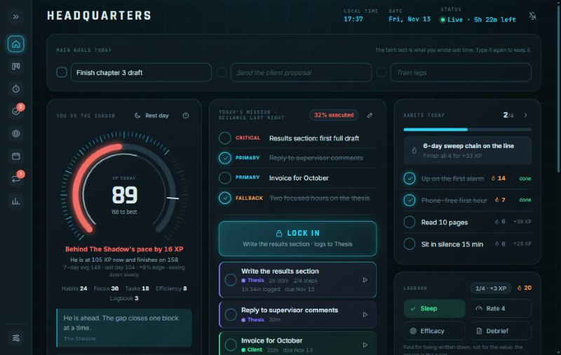
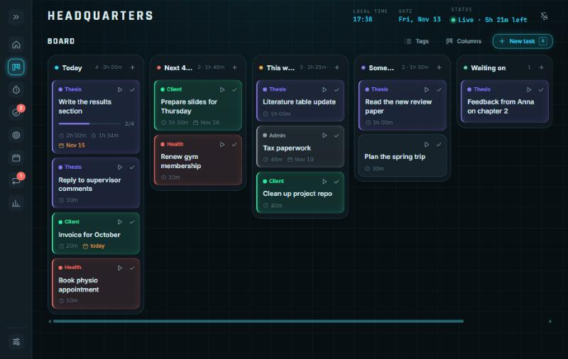
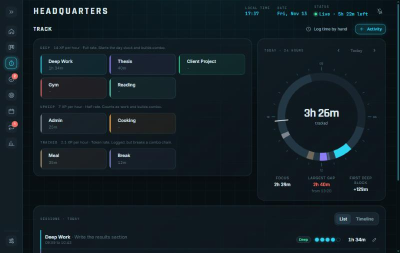
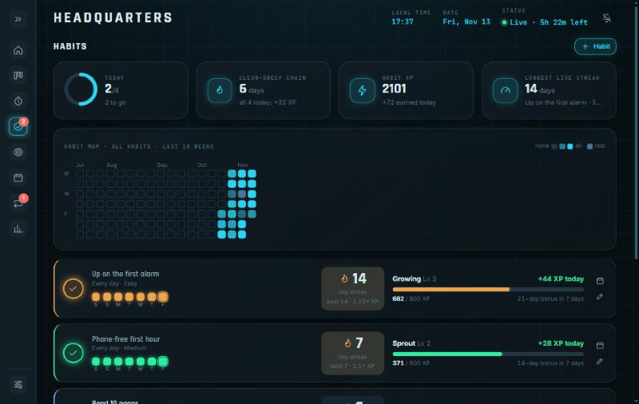
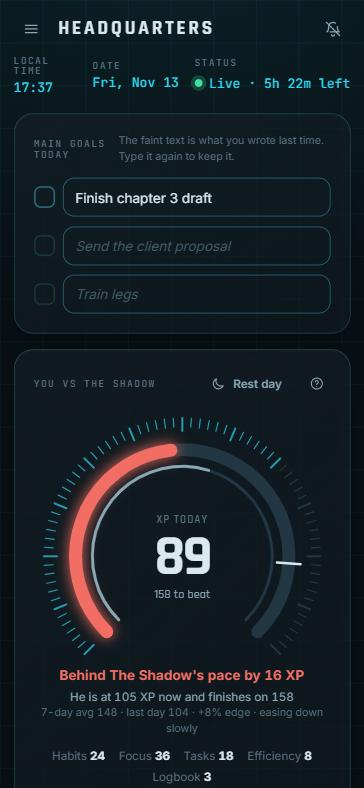

# Personal Dashboard

A private, self-hosted dashboard for running your day: tasks, time tracking, habits, goals, and a rival built from your own track record who sets the bar each morning.



It is a plain web app with no build step and no dependencies. Fork it, connect it to Netlify, and you have your own copy in about a minute. It installs as an app on Windows, macOS, Android and iOS.

**New here? Read [HOW-TO-USE.md](HOW-TO-USE.md).** It covers setup on every platform and how to get the most out of it, with pictures.

## What it does

- **Home.** Your main goals, you against your rival, today's mission, a one-press Lock in on your top tasks, habits, and a daily logbook.
- **Board.** A kanban board. Tasks carry a tag, estimate, deadline, notes and steps, and can be duplicated. A task's tag decides which activity its time is logged under.
- **Track.** Activity timers, a 24-hour ring of your day, a timeline, and editable sessions.
- **Habits.** Streaks and XP levels in plain sight, a clean-sweep chain for doing all of them, and habit maps.
- **Goals, Calendar, Subscriptions, Review.** Milestones with time tracking, a month view, recurring payments, and the week in numbers with a journal.
- **Gym.** Progress per exercise and a suggestion for your next session, from Hevy or an export file.
- **Finance.** Spending by category, month and year, from statement files of any bank or a read-only bank link.
- **A game layer you can rename or switch off.** A rival that adapts to your last week, missions and execution, rank and reputation, rest days, and fixed-length campaigns with their own red theme.
- **Yours to shape.** Light, dark or system theme, any accent colour, five typefaces, your own background image, renameable labels, editable notification wording, reorderable tabs, motion and sound you can turn down or off.

| Board | Track |
|---|---|
|  |  |

| Habits | On a phone |
|---|---|
|  |  |

## Quick start

**Online:** fork this repository, then in Netlify choose *Add new site > Import an existing project* and pick your fork. There is nothing to configure.

**On your own machine:**

```bash
npm run dev
```

Then open `http://localhost:5173`. This needs [Node.js](https://nodejs.org) 20 or later and installs nothing.

## Your data

Your data stays in your browser. Netlify only serves the app's files and never sees it.

Sync between devices and notifications with the app closed are optional. They use your own free Supabase project behind your own login, with row level security so the database refuses anyone else. Setup takes about ten minutes: see [Part 5 of the guide](HOW-TO-USE.md#5-optional-sync-between-devices).

There is no analytics, no tracking and no third-party script. The only outside request is the optional "Classic" typeface from Google Fonts, which you can switch off in Settings. See [SECURITY.md](SECURITY.md).

## Project layout

```
app/                    the published site (this folder is all Netlify serves)
  index.html
  css/                  tokens.css (theme variables), app.css, views.css
  js/
    engine.js           every score and number; no DOM, fully tested
    store.js            the state document and local storage
    merge.js            combines two copies without losing either side
    sync.js             optional Supabase sync, plain fetch, no SDK
    notify.js           reminders and the push plan
    theme.js, ui.js, flows.js, charts.js, icons.js, main.js
    views/              one file per tab
  sw.js                 offline support and push
netlify/functions/      config, push-subscribe, push-drain, push-now, push-health
netlify/lib/            web push (no dependency), auth helpers, queue drainer
supabase/schema.sql     tables and row level security
tests/                  engine and merge tests
tools/                  dev server, icon generator, push key generator, demo data
```

## Development

```bash
npm run dev      # local server with the same security headers as production
npm test         # engine and merge tests
npm run demo     # write demo-backup.json, importable under Settings > Data
npm run icons    # regenerate the app icons
npm run vapid    # make a push key pair
```

The design rule throughout: **store facts, derive scores.** Sessions, check-offs and settled days are stored. XP, streaks, reputation and records are computed from them, so nothing can drift between devices.

## Licence

MIT. See [LICENSE](LICENSE).
